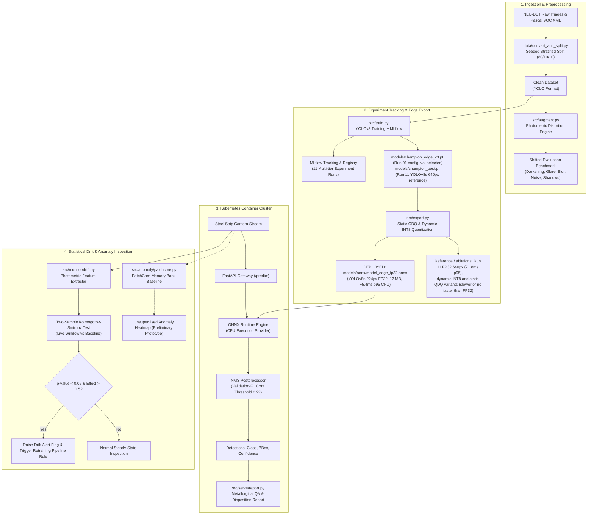
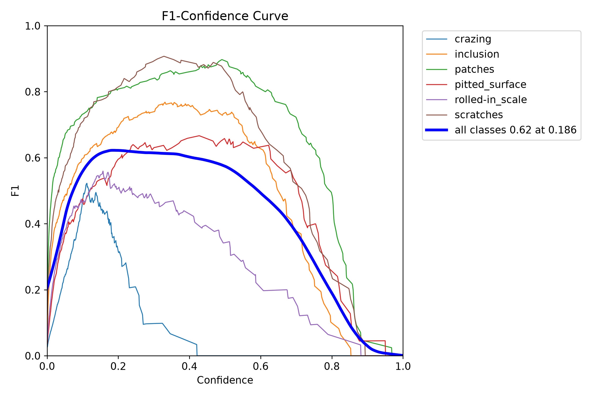
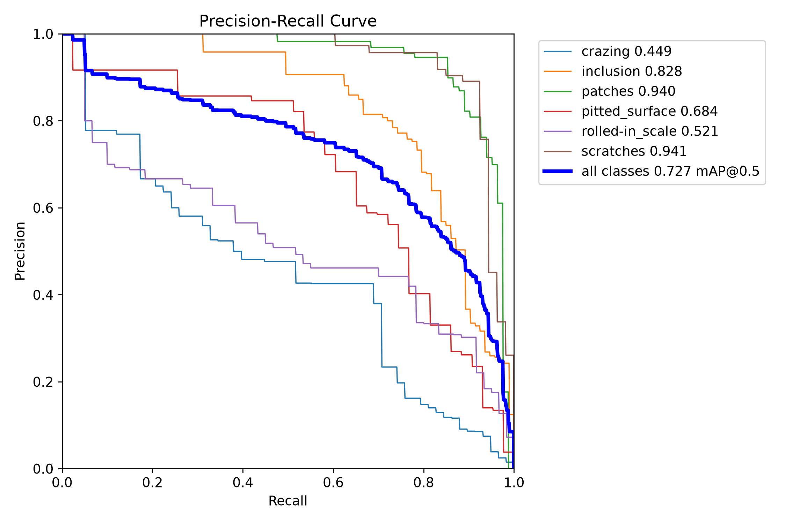
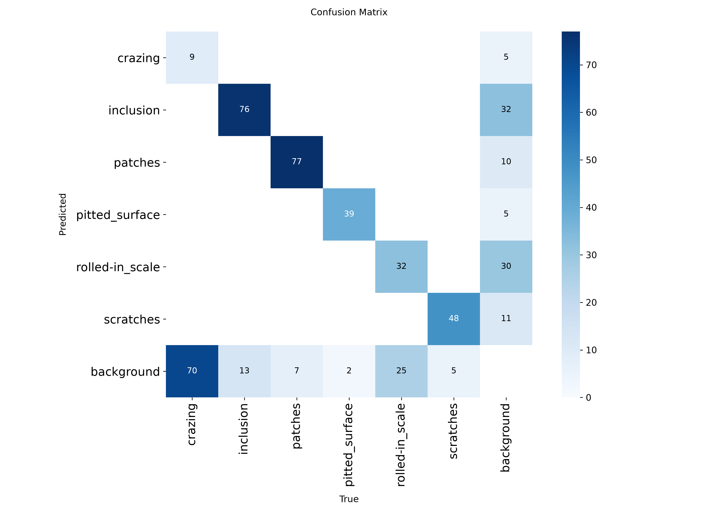
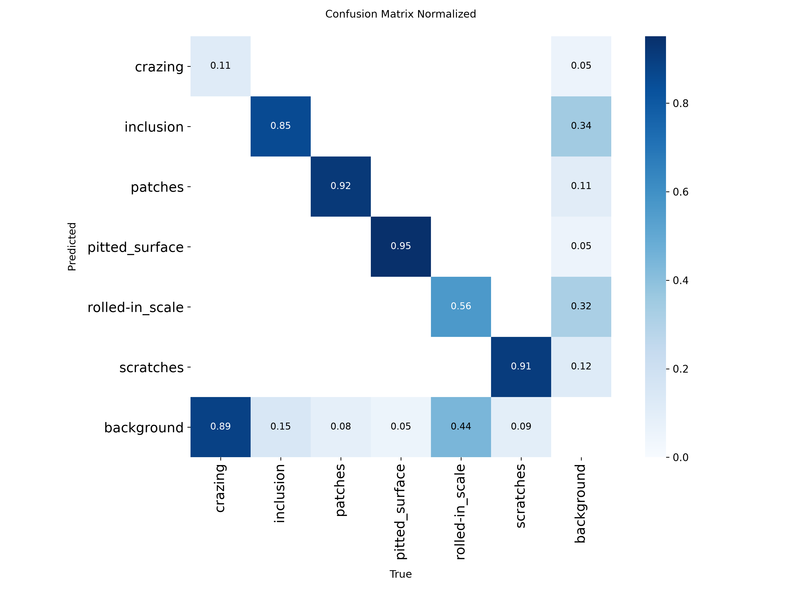

# Industrial Steel Surface Defect Inspection Service

[](https://github.com/ParaDhim/neu-det-defect-inspection-service/actions)
[](https://github.com/astral-sh/uv)
[](https://www.python.org/)
[](https://onnxruntime.ai/)
[](https://fastapi.tiangolo.com/)
[](LICENSE)

> **One-line Pitch:** An end-to-end metallurgical defect-detection and quality-assurance platform: YOLOv8 training, statistical drift monitoring and containerized deployment. The deployed model is **YOLOv8n at 224px, FP32 ONNX (12 MB)**, selected on the *validation* split from a 3-seed experiment. It runs at **about 5.4 ms p95 on CPU (~190 FPS)** with 74.2% clean / 26.8% shifted test mAP50 (single checkpoint; the config averages 72.5 ± 1.4% clean over 3 seeds). All accuracy numbers use one protocol (`conf=0.001`, `rect=False`). Dynamic INT8 quantization was **slower, not faster**, on this CPU. Managed with **Astral `uv`**.

---

## Visual Defect Inspection Gallery


*Figure 1: Automated defect localizations on test steel surfaces across all 6 target defect classes (`crazing`, `inclusion`, `patches`, `pitted_surface`, `rolled-in_scale`, `scratches`) with predicted bounding boxes and calibrated class confidence scores.*

---

## Table of Contents
1. [System Architecture](#system-architecture)
2. [Dataset & Stratified Distribution](#dataset--stratified-distribution)
3. [Experiment Tracking & Research Results](#experiment-tracking--research-results)
4. [Precision, Recall & F1 Evaluation Across Splits](#precision-recall--f1-evaluation-across-splits)
5. [Harsh Lighting Shift & Robustness Analysis](#harsh-lighting-shift--robustness-analysis)
6. [Error Analysis & Confusion Matrix](#error-analysis--confusion-matrix)
7. [Edge Export & CPU Benchmarking (FP32 vs Dynamic INT8 vs Static QDQ)](#edge-export--cpu-benchmarking-fp32-vs-dynamic-int8-vs-static-qdq)
8. [Covariate Drift Monitoring & Automated Retraining Trigger](#covariate-drift-monitoring--automated-retraining-trigger)
9. [Unsupervised Anomaly Baseline (PatchCore vs Supervised YOLO)](#unsupervised-anomaly-baseline-patchcore-vs-supervised-yolo)
10. [Automated Metallurgical & LLM Reporting](#automated-metallurgical--llm-reporting)
11. [Serving API Specification](#serving-api-specification)
12. [Containerization & Kubernetes Deployment](#containerization--kubernetes-deployment)
13. [When ML is NOT the Right Answer](#when-ml-is-not-the-right-answer)
14. [Quickstart & Reproduction Guide (`uv` Native)](#quickstart--reproduction-guide-uv-native)

---

## System Architecture



---

## Dataset & Stratified Distribution

The primary benchmark is **NEU-DET (Northeastern University Steel Surface Defect Database)** consisting of hot-rolled steel strip surface defects across six metallurgical defect classes.

### Dataset Verification & Clean VOC-to-YOLO Conversion
- **Upstream License:** Academic research release (Song Kechen & Yan Yunhui, IEEE TIM 2020).
- **Images:** 1,800 total unique images ($200 \times 200$).
- **Annotations:** Pascal VOC XML normalized to YOLO bounding box format $[x_{\text{center}}, y_{\text{center}}, w, h] \in [0.0, 1.0]$.
- **Partition:** Seeded, class-stratified split (**80% Train, 10% Val, 10% Test**) using `seed=42`: **1,441 Train, 180 Val, 179 Test**. Zero leakage verified across split partitions.
- **Drift Baseline Extracted:** 1,438 training images with valid verified bounding boxes had baseline photometric statistics extracted.

### Class Distribution Summary

| Class ID | Defect Class | Train Images | Val Images | Test Images | Total Images with Class | Train Boxes | Val Boxes | Test Boxes | Total Boxes |
|:---:|:---|:---:|:---:|:---:|:---:|:---:|:---:|:---:|:---:|
| 0 | `crazing` | 240 | 30 | 30 | 300 | 552 | 58 | 79 | 689 |
| 1 | `inclusion` | 307 | 38 | 37 | 382 | 829 | 93 | 89 | 1011 |
| 2 | `patches` | 278 | 33 | 31 | 342 | 715 | 82 | 84 | 881 |
| 3 | `pitted_surface` | 241 | 30 | 30 | 301 | 348 | 43 | 41 | 432 |
| 4 | `rolled-in_scale` | 240 | 30 | 30 | 300 | 511 | 60 | 57 | 628 |
| 5 | `scratches` | 240 | 30 | 30 | 300 | 442 | 53 | 53 | 548 |
| **Total** | **All Unique Images** | **1,441** | **180** | **179** | **1,800** | **3,397** | **389** | **403** | **4,189** |

*Note on Multi-Label Co-occurrence: In the table above, the sum of image presences across individual classes equals 1,925 (greater than the 1,800 unique images) because individual steel strip images frequently contain multiple distinct defect categories co-occurring on the same strip surface (for example, non-metallic inclusions appearing in proximity to rolled-in scale).*

---

## Experiment Tracking & Research Results

We executed a systematic Design of Experiments (DOE) logged into **MLflow** (`sqlite:///mlflow.db`). Models were evaluated on both the canonical **Clean Test Set** and the physically perturbed **Shifted-Lighting Benchmark**.

### Master Experiment Comparison Table (all 11 DOE runs, single seed, one protocol)

**Protocol (every mAP in this README):** NEU-DET images at the model's native resolution, `conf=0.001`, NMS IoU 0.7, `rect=False` (`scripts/eval_all_runs.py`, `reports/unified_eval_conf001.json`). Validation = the 180-image val split. Test and shifted = the 179-image test split and its shifted-lighting copy. **The shifted benchmark has no separate validation split, so model selection uses clean validation mAP50 only.**

| Run ID | Arch | Res | Augmentation / optimizer | **Val mAP50** | Test mAP50 | Shifted test mAP50 | Test mAP50-95 | Weights |
|:---|:---|:---:|:---|:---:|:---:|:---:|:---:|:---|
| `01_baseline_yolov8n_imgsz200` | YOLOv8n | 200 | No HSV, mosaic or scale augmentation; translate 0.1 and horizontal + vertical flips on; no rotation, mixup, copy-paste or erasing; `optimizer=auto` (resolved to **AdamW, lr0 = 0.001, momentum 0.9**: Ultralytics' auto rule picks AdamW below 10,000 iterations, and this run has ceil(1441/64) x 10 = 230; derived from the library source, as the checkpoints do not record it), 10 epochs | **70.3%** | 71.7% | 25.9% | 40.0% | retrained |
| `02_baseline_yolov8n_imgsz320` | YOLOv8n | 320 | High-res clean baseline | **69.5%** | 71.5% | 23.4% | 39.8% | retrained |
| `03_robust_yolov8n_light_aug` | YOLOv8n | 224 | Light aug (HSV v=0.2, mosaic 0.5) | **68.9%** | 70.9% | 24.1% | 34.9% | retrained |
| `04_robust_yolov8n_heavy_aug` | YOLOv8n | 224 | Heavy aug (HSV v=0.6, scale, erasing) | **66.0%** | 63.9% | 18.1% | 25.2% | retrained |
| `05_robust_yolov8s_heavy_aug` | YOLOv8s | 224 | Capacity scaling + heavy aug | **66.4%** | 65.3% | 23.4% | 27.0% | retrained |
| `06_robust_yolov8n_adamw_cosine` | YOLOv8n | 224 | AdamW lr 0.002, medium aug | **67.5%** | 67.1% | 23.9% | 34.9% | retrained |
| `07_robust_yolov8n_sgd_momentum` | YOLOv8n | 224 | SGD lr 0.01, medium aug | **66.6%** | 66.4% | 34.3% | 33.5% | retrained |
| `08_robust_yolov8n_geom_heavy` | YOLOv8n | 224 | Heavy geometric aug (rot 30) | **56.4%** | 57.6% | 15.3% | 22.3% | retrained |
| `09_robust_yolov8n_imgsz320_heavy` | YOLOv8n | 320 | 320px + heavy aug | **63.5%** | 62.7% | 16.8% | 26.4% | retrained |
| `10_champion_yolov8n_production` | YOLOv8n | 224 | AdamW + tuned photometric aug (12 ep) | **58.0%** | 61.7% | 19.9% | 22.7% | original |
| `11_yolov8s_640_heavy_aug` | YOLOv8s | 640 | AdamW + cosine LR + CopyPaste + scale (80 ep) | **70.4%** | 68.3% | 24.1% | 30.3% | original |

- **Run 01's augmentation, exactly** (from the saved training args): No HSV, mosaic or scale augmentation; translate 0.1 and horizontal + vertical flips on; no rotation, mixup, copy-paste or erasing; `optimizer=auto` (resolved to **AdamW, lr0 = 0.001, momentum 0.9**: Ultralytics' auto rule picks AdamW below 10,000 iterations, and this run has ceil(1441/64) x 10 = 230; derived from the library source, as the checkpoints do not record it), 10 epochs. It is *not* the Ultralytics default, which has HSV, mosaic and scale on. This is the deployed config.
- Only the Run 10 and Run 11 weights were archived; Runs 01-09 were retrained with `seed=0` (`scripts/retrain_runs_01_09.py`). Nominal 200px training is rounded up to 224 by Ultralytics (stride 32), so Runs 01 and 03-08 in practice share the same 224px input.
- Earlier versions of this README mixed protocols (conf 0.25 with `rect=True`, shifted scored on the val split, ONNX at conf 0.001). Those numbers are retired.

### Multi-seed results (3 seeds, mean ± sample std; `scripts/train_seeds.py`, `scripts/eval_seeds.py`)

| Config | Val mAP50 | Test mAP50 | Test mAP50-95 | Shifted test mAP50 | Test crazing AP50 |
|:---|:---:|:---:|:---:|:---:|:---:|
| Run 01 config (no HSV/mosaic/scale; translate + flips only; 200px nominal) | 71.6 ± 1.2 | 72.5 ± 1.4 | 40.3 ± 0.2 | 25.2 ± 1.9 | 36.1 ± 2.1 |
| Run 06 config (AdamW lr 0.002, HSV + mosaic 0.8) | 66.9 ± 1.2 | 67.4 ± 2.3 | 34.9 ± 2.2 | 21.8 ± 2.4 | 29.1 ± 2.8 |
| Run 07 config (SGD lr 0.01, HSV + mosaic 0.8) | 66.5 ± 0.5 | 66.8 ± 0.4 | 33.8 ± 1.2 | 32.3 ± 1.7 | 31.4 ± 5.0 |
| Run 10 config (AdamW, tuned aug, 12 ep) | 56.5 ± 2.4 | 56.4 ± 3.5 | 21.9 ± 2.0 | 22.6 ± 0.7 | 23.6 ± 5.9 |
| Run 11 config (YOLOv8s, 640px, 80 ep) | 72.9 ± 2.2 | 71.3 ± 2.6 | 33.4 ± 2.6 | 25.3 ± 2.4 | 41.0 ± 4.8 |

How to read this (n=3 per config, 179 test images, so intervals are wide):
- **Run 10 was a weak config, and its archived number was optimistic.** Retrained seeds average 56.4 ± 3.5% test mAP50, below the archived checkpoint's 61.7% and far below Runs 01 and 11. The earlier deployment of Run 10 was not justified.
- **Run 01 and Run 11 are indistinguishable on clean accuracy** (val 71.6 ± 1.2 vs 72.9 ± 2.2; test 72.5 ± 1.4 vs 71.3 ± 2.6), and on shifted mAP50 (25.2 ± 1.9 vs 25.3 ± 2.4). The 640px, 80-epoch YOLOv8s config shows no demonstrated aggregate advantage over the 224px YOLOv8n default, at ~13x the latency. Its one visible edge is `crazing` AP50 (41.0 ± 4.8 vs 36.1 ± 2.1), a modest gap on 30 images.
- **Run 07's shifted-lighting result is real, not noise.** SGD with medium augmentation reaches 32.3 ± 1.7% shifted mAP50 against 25.2 ± 1.9 (Run 01) and 25.3 ± 2.4 (Run 11), with non-overlapping seed ranges. The controlled comparison is Run 06 vs Run 07: identical augmentation and epochs, but the optimizer *and its learning rate* both differ (AdamW lr0 0.002 vs SGD lr0 0.01), so the effect cannot be attributed to the optimizer algorithm alone; a learning-rate sweep for each optimizer would be needed to separate them. Both reach about 67% clean test mAP50, but shifted mAP50 is 21.8 ± 2.4 (AdamW) vs 32.3 ± 1.7 (SGD), a ~10 pp gap. So under this protocol the optimizer/learning-rate choice, not the augmentation, accounts for the robustness gain. **Why** is untested; plausible explanations (flatter minima, less reliance on fine texture) are hypotheses. Run 07 pays ~5 pp of clean mAP50 relative to Run 01.
- Under lighting shift every config loses 32-46 pp of mAP50; none of the recipes made the model robust in absolute terms.

### Model selection (validation only)

1. Rank the 11 single-seed runs on **validation** mAP50: Run 11 (70.4) and Run 01 (70.3) lead; Run 10 ranks 10th of 11 (58.0).
2. Re-run the leading and the notable configs with 3 seeds. By mean validation mAP50, Run 11 (72.9 ± 2.2) and Run 01 (71.6 ± 1.2) are statistically tied.
3. Tie-break on cost: Run 01 is a 224px YOLOv8n that runs in about 5 ms on CPU, versus ~72 ms for Run 11. **Run 01's config is deployed.** The checkpoint is the seed with the best validation mAP50 (seed 2), `models/champion_edge_v3.pt`.
4. Test and shifted numbers are then reported once for the chosen checkpoint (below). **Caveat:** test and shifted scores of earlier runs were visible while this README was developed, so the test split is not a pristine hold-out; the selection rule itself uses validation only.
5. If lighting robustness matters more than clean accuracy, Run 07's SGD recipe is the documented alternative (validation 66.5 ± 0.5, shifted 32.3 ± 1.7). It was not chosen because it is not best on the validation criterion.

### Per-Class AP50, 3-seed mean ± std: Run 01 config (deployed) vs Run 11 config (clean test)

| Defect Class | Run 01 config | Run 11 config | Run 11 minus Run 01 (pp) |
|:---|:---:|:---:|:---:|
| `crazing` | 36.1 ± 2.1 | 41.0 ± 4.8 | +4.9 |
| `inclusion` | 82.5 ± 1.0 | 82.3 ± 2.2 | -0.2 |
| `patches` | 93.6 ± 1.7 | 92.5 ± 2.5 | -1.0 |
| `pitted_surface` | 88.9 ± 2.4 | 83.8 ± 1.6 | -5.1 |
| `rolled-in_scale` | 46.2 ± 3.2 | 53.4 ± 1.9 | +7.2 |
| `scratches` | 87.5 ± 3.1 | 74.7 ± 7.7 | -12.8 |

Means over seeds 0-2 for each config (`reports/seed_eval_conf001.json`, protocol `conf=0.001`, `rect=False`). The last column is Run 11 minus Run 01, so negative values mean Run 01 is better. Single-checkpoint per-class comparisons were dropped: the archived Run 11 checkpoint is a below-average seed (68.4% vs a 3-seed mean of 71.3%), so they overstated Run 01's lead (for example on `scratches`). With n=3 and 30-90 boxes per class, only gaps larger than the two stds combined are credible: Run 11 is better on `rolled-in_scale` (+7.2) and probably `crazing` (+4.9), Run 01 is better on `scratches` (-12.8) and `pitted_surface` (-5.1), and `inclusion` and `patches` are ties. Neither config dominates per class.

---

## Precision, Recall & F1 Evaluation Across Splits

Operating point per model = its **validation-split macro-F1-optimal confidence** under this protocol (`scripts/f1_optimal_conf.py`): **0.22 for the deployed edge model, 0.19 for Run 11 FP32**; NMS IoU 0.45, `rect=False`, native resolution (`scripts/eval_operating_point.py`, `reports/operating_point_opt.json`).

**Averaging, stated explicitly.** All P/R/F1 values in the tables below are computed from the confusion-matrix counts shown in the Error Analysis section. *Macro* = unweighted mean of the six per-class precisions TP/(TP+FP) and recalls TP/(TP+FN); macro F1 = harmonic mean of macro P and R. *Micro* = pooled counts over all boxes. Ultralytics' own `mp`/`mr` (saved in the JSON as `ultralytics_macro_*`, e.g. test 0.734/0.709 for the edge model) come from interpolated P/R curves at the best-F1 confidence with a different matching rule, so they do not reconcile with the counts and are not used.

### Deployed edge model: YOLOv8n 224px FP32 (Run 01 config, seed 2)

| Split | Macro P | Macro R | Macro F1 | Micro P | Micro R | Micro F1 |
|:---|:---:|:---:|:---:|:---:|:---:|:---:|
| Train (1,441 img) | 0.789 | 0.734 | 0.761 | 0.787 | 0.742 | 0.764 |
| Validation (180 img) | 0.749 | 0.703 | 0.725 | 0.749 | 0.722 | 0.736 |
| Test, clean (179 img) | 0.741 | 0.717 | 0.729 | 0.751 | 0.697 | 0.723 |
| Test, shifted (179 img) | 0.532 | 0.305 | 0.388 | 0.437 | 0.275 | 0.338 |

### Run 11 FP32 (YOLOv8s, 640px)

| Split | Macro P | Macro R | Macro F1 | Micro P | Micro R | Micro F1 |
|:---|:---:|:---:|:---:|:---:|:---:|:---:|
| Train (1,441 img) | 0.754 | 0.779 | 0.767 | 0.749 | 0.794 | 0.771 |
| Validation (180 img) | 0.693 | 0.740 | 0.716 | 0.696 | 0.761 | 0.727 |
| Test, clean (179 img) | 0.699 | 0.743 | 0.721 | 0.681 | 0.747 | 0.712 |
| Test, shifted (179 img) | 0.435 | 0.261 | 0.326 | 0.393 | 0.238 | 0.297 |

Both models fit the training split better than val/test, and both lose roughly half their recall under the lighting shift.

<p align="center">
  
  
</p>
<p align="center"><em>Figure 2: Deployed edge model (224px FP32), validation split, evaluated at conf=0.001. (Left) F1-confidence curve; (Right) precision-recall curves per class. Run 11 FP32 equivalents: <code>reports/run11_fp32_Box*_curve.png</code>.</em></p>

---

## Harsh Lighting Shift & Robustness Analysis

In real-world steel manufacturing, visual inspection cameras suffer from harsh factory conditions:
1. **Severe Under-exposure & Over-exposure:** Conveyor lighting fluctuation and variable coil reflectivity.
2. **Specular Reflections & Hotspots:** High-intensity halogen lamps producing localized glare rings.
3. **Occlusion & Shadow Casts:** Overhead gantry arms, tension levelers, and roller frames casting directional shadows.
4. **Thermal Grain & Sensor Noise:** High ambient temperature in hot rolling mills.
5. **Defocus & Vibration Blur:** High-speed line velocities ($15-25 \text{ m/s}$).


*Figure 3: Side-by-side visual comparison of test images under canonical clean inspection lighting (Left) versus harsh simulated industrial plant perturbations with shadows, noise, and glare (Right).*

### Per-Class AP50: Clean vs Shifted (3-seed mean ± std)

| Defect Class | Run 01 clean | Run 01 shifted | Change (pp) | Run 11 clean | Run 11 shifted | Change (pp) |
|:---|:---:|:---:|:---:|:---:|:---:|:---:|
| `crazing` | 36.1 ± 2.1 | 14.1 ± 3.9 | -22.1 | 41.0 ± 4.8 | 12.2 ± 1.0 | -28.8 |
| `inclusion` | 82.5 ± 1.0 | 10.4 ± 1.3 | -72.1 | 82.3 ± 2.2 | 12.4 ± 2.2 | -69.9 |
| `patches` | 93.6 ± 1.7 | 54.9 ± 5.6 | -38.7 | 92.5 ± 2.5 | 50.3 ± 3.5 | -42.2 |
| `pitted_surface` | 88.9 ± 2.4 | 29.2 ± 2.6 | -59.7 | 83.8 ± 1.6 | 30.5 ± 1.0 | -53.3 |
| `rolled-in_scale` | 46.2 ± 3.2 | 5.2 ± 1.1 | -41.1 | 53.4 ± 1.9 | 5.4 ± 1.9 | -48.1 |
| `scratches` | 87.5 ± 3.1 | 37.8 ± 2.6 | -49.7 | 74.7 ± 7.7 | 41.0 ± 11.6 | -33.7 |

`scratches` and `patches` degrade least; `inclusion` and `rolled-in_scale` fall to near zero for both configs. Shifted AP50 per class rests on 30-40 images; explanations for each drop (shadow confusion, defocus, underexposure) are hypotheses, not tested ablations.

---

## Error Analysis & Confusion Matrix

<p align="center">
  
  
</p>
<p align="center"><em>Figure 4: Deployed edge model (224px FP32), clean test split, conf=0.22. (Left) raw counts. (Right) normalized by column, i.e. by ground-truth class (each column sums to 1). Rows are predictions, columns are ground truth. Run 11 matrices: <code>reports/confusion_matrix_run11_fp32*.png</code>.</em></p>

*Clean test split: 179 images, 403 ground-truth boxes, IoU matching 0.45. TP = correct-class match, FN = ground truth with no correct-class match, FP = prediction with no correct-class ground truth. Counts come from the Ultralytics confusion matrix.*

**Deployed edge model (conf=0.22):**

| Class | GT | TP | FN | FP | Recall | Precision |
|:---|:---:|:---:|:---:|:---:|:---:|:---:|
| `crazing` | 79 | 9 | 70 | 5 | 11% | 64% |
| `inclusion` | 89 | 76 | 13 | 32 | 85% | 70% |
| `patches` | 84 | 77 | 7 | 10 | 92% | 89% |
| `pitted_surface` | 41 | 39 | 2 | 5 | 95% | 89% |
| `rolled-in_scale` | 57 | 32 | 25 | 30 | 56% | 52% |
| `scratches` | 53 | 48 | 5 | 11 | 91% | 81% |

**Run 11 FP32 (conf=0.19):**

| Class | GT | TP | FN | FP | Recall | Precision |
|:---|:---:|:---:|:---:|:---:|:---:|:---:|
| `crazing` | 79 | 32 | 47 | 22 | 41% | 59% |
| `inclusion` | 89 | 82 | 7 | 53 | 92% | 61% |
| `patches` | 84 | 75 | 9 | 14 | 89% | 84% |
| `pitted_surface` | 41 | 31 | 10 | 3 | 76% | 91% |
| `rolled-in_scale` | 57 | 35 | 22 | 28 | 61% | 56% |
| `scratches` | 53 | 46 | 7 | 21 | 87% | 69% |

1. **`crazing` is the deployed model's weakness at the global threshold:** 9 of 79 boxes (11% recall) versus 32 of 79 (41%) for Run 11. A crazing-specific threshold recovers most of the gap (next paragraph).
2. `rolled-in_scale` is weak for both models (recall 56% edge, 61% Run 11).
3. Cross-class confusions are negligible; nearly all errors are defect-versus-background misses or false alarms. `inclusion` has the most false positives for both models.

**Per-class threshold for `crazing`.** The global 0.22 threshold leaves crazing scores below the cut. Tuned on the *validation* split only (`scripts/crazing_threshold.py`, `reports/crazing_threshold.json`), the crazing-specific F1-optimal threshold is **0.112**. Results at that threshold, with every other class still at 0.22:

| Crazing at | Val TP / FP / FN | Val recall / precision | Test TP / FP / FN | Test recall / precision |
|:---|:---:|:---:|:---:|:---:|
| global 0.22 | 10 / 3 / 48 | 17% / 77% | 9 / 5 / 70 | 11% / 64% |
| tuned 0.112 | 40 / 36 / 18 | 69% / 53% | 34 / 31 / 45 | 43% / 52% |

Crazing recall on the test split rises from 11% to 43% (Run 11 FP32 at its global threshold: 41%) at the cost of 26 more crazing false positives. Overall test micro recall goes 0.697 → 0.759, micro precision 0.751 → 0.720; macro recall 0.717 → 0.770, macro precision 0.741 → 0.721. This is now the service default (`CLASS_CONF_THRESHOLDS={"crazing": 0.112}`). The confusion matrices above are at the global 0.22 threshold only; the threshold was tuned on one split of 58 validation crazing boxes, so expect some optimism.


---

## Edge Export & CPU Benchmarking (FP32 vs Dynamic INT8 vs Static QDQ)

We exported models to ONNX opset 17 and systematically compared **FP32**, **Dynamic INT8**, and **Static QDQ INT8 (with Calibration Data)** on CPU.

### Benchmark Environment
- **Processor:** Intel(R) Xeon(R) Gold 6242R CPU @ 3.10GHz
- **Execution Provider:** ONNX Runtime 1.31.0 (`CPUExecutionProvider`)
- **Execution Config:** 4 intra-op threads, single-stream batch size = 1
- **Iterations:** 15 warmup + 100 timed runs per model, two passes (`scripts/bench_all_onnx.py`)
- **Accuracy Split:** NEU-DET test split (179 images) evaluated under the standard detection protocol across the full precision-recall curve at `conf=0.001` with `rect=False` (operational metrics at each model's validation-F1-optimal threshold: 0.22 edge, 0.19 Run 11).

### CPU Latency, Memory Footprint & Quantization Accuracy Comparison

Accuracy = unified protocol (`conf=0.001`, `rect=False`), test split, single checkpoints.

| Model | Role | Footprint | p50 | p95 | FPS | Size vs FP32 | Test mAP50 (shifted) |
|:---|:---|:---:|:---:|:---:|:---:|:---:|:---:|
| Run 01-config YOLOv8n FP32, 224px | **DEPLOYED** | 12.05 MB | 4.3–5.3 ms | **5.4–5.9 ms** | 189.2–202.3 | baseline | 74.2% (26.8%) |
| Run 01-config YOLOv8n dynamic INT8, 224px | size-only option | 3.18 MB | 28.1–28.6 ms | **28.4–29.1 ms** | 35.0–35.5 | -73.6% | 73.5% (25.8%) |
| Run 10 YOLOv8n FP32, 224px | archived | 12.02 MB | 4.1–5.2 ms | **5.4–5.7 ms** | 190.1–233.5 | baseline | 61.7% (19.9%) |
| Run 10 YOLOv8n dynamic INT8, 224px | archived | 3.17 MB | 28.1–28.4 ms | **28.4–28.8 ms** | 35.2–35.5 | -73.6% | 61.8% (21.1%) |
| YOLOv8s FP32, 640px (Run 11) | accuracy reference, crazing | 42.68 MB | 70.1–70.8 ms | **72.1–72.5 ms** | 14.1–14.2 | baseline | 68.3% (24.1%) |
| YOLOv8s dynamic INT8, 640px | ablation | 10.96 MB | 416.6 ms | **424.0–426.7 ms** | 2.4 | -74.3% | 59.1% (20.5%) |
| YOLOv8s static QDQ INT8, 640px | ablation | 17.01 MB | 75.2–76.0 ms | **75.8–76.6 ms** | 13.2–13.3 | -60.1% | 65.7% (20.6%) |

Latency comes from `scripts/bench_all_onnx.py`: every model benchmarked back-to-back in one session on the Intel Xeon Gold 6242R, ONNX Runtime 1.31.0, CPUExecutionProvider, 4 intra-op threads, batch 1, 15 warmup + 100 timed runs, two passes (ranges are min–max across the two passes; `reports/latency_same_session.json`).

**Correction to earlier versions of this README.** They reported the 224px dynamic INT8 model at 7.4 ms p95 and 154 FPS, slightly *faster* than FP32 (7.3 ms). That did not reproduce: re-benchmarked back-to-back with the same settings, 224px dynamic INT8 takes about 28 ms p95, roughly **5x slower than FP32 (about 5.4 ms)**, matching the 640px behavior (about 5.8x slower). The earlier figure came from a previous benchmark session whose configuration was not recorded, so it is retired. Dynamic INT8 at 224px keeps accuracy (see the table) and is 73.6% smaller, but there is no latency benefit on this CPU.

**.pt vs ONNX parity.** Under this protocol each `.pt` matches its FP32 ONNX export within 0.03 pp mAP50, and raw outputs agree to ~1e-3. An earlier 7-point gap (75.4% `.pt` vs 68.3% ONNX) was an evaluation artifact: Ultralytics validates `.pt` models with `rect=True`, which pads 200x200 images to `ceil(imgsz/32 + 0.5) x 32` (672px at `imgsz=640`), so the `.pt` ran at a higher effective resolution than the fixed-shape ONNX.

### Technical Post-Mortem: Quantization on this CPU
1. **Dynamic INT8 slowed inference at both resolutions** (about 5x slower at 224px and 5.8x at 640px). Weights are quantized offline but activation scales are computed at runtime for every layer, and the convolutional graph pays that overhead (and possible FP32 fallbacks). This explanation is a hypothesis; per-operator profiling was not done.
2. **Static QDQ (640px)** removed the runtime scaling and shrank the file 60.1% (42.68 to 17.01 MB) but is not faster than FP32 (about 75 vs 72 ms p95) and costs 2.7 pp mAP50 at 640px. Dynamic INT8 at 640px costs 9.3 pp. QDQ was not tried at 224px. Untested next steps: a CPU with VNNI/AVX-512 INT8 acceleration, and excluding the detection head from quantization.
3. Differences of 1-2 pp between quantized and FP32 models (for example 73.5 vs 74.2 for the edge model) are within noise on 179 images.

### Deployment Decision

- **Deployed: YOLOv8n 224px FP32** (`models/onnx/model_edge_fp32.onnx`, `CONF_THRESHOLD=0.22`, crazing override 0.112). Chosen on validation mAP50 (see Model selection), about 5.4 ms p95 / ~190 FPS, 12 MB. `MODEL_PATH`, Docker Compose, the k8s ConfigMap and CI all point to it.
- **Reference: Run 11 FP32.** No demonstrated aggregate gain; slightly higher `crazing` AP50 across seeds. With the crazing threshold the edge model's crazing recall is comparable, so switch only if the extra false positives at the low crazing threshold are unacceptable.
- **Size-constrained option: edge dynamic INT8** (3.18 MB) with equal accuracy but ~5x the latency of FP32.
- **Ablations only:** 640px dynamic INT8 and static QDQ. Neither beats FP32 on speed or overall accuracy, and neither is recommended for deployment.

---

## Covariate Drift Monitoring & Automated Retraining Trigger

Visual inspection systems in metallurgy inevitably experience distribution drift due to lamp degradation, lens contamination, and seasonal temperature variance.

### Statistical Framework
- **Photometric Feature Tracking:** Every inference image is evaluated for **Brightness** (mean intensity $\mu$), **Contrast** (standard deviation $\sigma$), **Sharpness** (Laplacian variance $\text{Var}(\nabla^2 I)$), and **Shannon Entropy**.
- **Two-Sample Kolmogorov-Smirnov Test:** A sliding window ($W=40-50$ requests) is evaluated against empirical baseline distributions ($N=1,438$ training images).
- **Automated Retraining Rule:** If $p\text{-value} < 0.05$ on Brightness/Contrast AND normalized effect size $\Delta = |\bar{X}_{\text{win}} - \mu_{\text{base}}| / \sigma_{\text{base}} > 0.5$, an automated warning alert is flagged and logged to Prometheus, raising a trigger flag for the offline retraining pipeline.

### Live Demonstration Verification (Simulated Darkening Stream)

```
[Phase 1: In-Distribution Clean Stream]
- Window Sample Size: 40
- Brightness Window Mean: 127.4 vs Baseline: 127.4 (KS p-value: 0.4591)
- Contrast Window Mean:   24.4 vs Baseline: 26.8 (KS p-value: 0.1286)
-> Result: DRIFT DETECTED: FALSE | TRIGGER RETRAINING: FALSE

[Phase 2: Simulated Plant Lighting Degradation Stream]
- Window Sample Size: 40 (Simulated lamp failure & cast shadows: -30 to -40 intensity shift)
- Brightness Window Mean: 95.7 vs Baseline: 127.4 (KS p-value: 1.63e-4, Effect Size: 0.72)
- Alarm Reason: "Brightness drift: window mean=95.7 vs baseline=127.4 (p=1.63e-4, effect=0.72)"
-> Result: DRIFT DETECTED: TRUE | TRIGGER RETRAINING: TRUE (Alert Flag Raised)
```

*Note on Augmentation vs Evaluation: `src/augment.py` was executed once offline to construct the static shifted-lighting test benchmark (`data/processed/neu-det-shifted/`). Training-time data augmentation operates dynamically within PyTorch/Ultralytics transforms on clean images to prevent data leakage.*

---

## Unsupervised Anomaly Baseline (PatchCore vs Supervised YOLO)

To explore scenarios with scarce or zero defect labels (e.g., commissioning a new alloy line), we implemented a prototype **PatchCore-style memory bank baseline** (`src/anomaly/patchcore.py`).

### Data Provenance & Prototype Evaluation
- **Training Set:** Trained on 50 defect-free steel surface patches harvested from non-defect background regions of NEU-DET (zero spatial overlap with ground-truth defect annotations).
- **Prototype AUROC:** Evaluated on 20 defect-free background patches vs 30 multi-class test defect images, yielding an image-level anomaly detection AUROC of 99.7% [95% CI: 98.5% - 100.0%].
- **Methodological Limitation:** Because normal patches were harvested as background crops from the same collection of images, this score represents an optimistic upper bound. A definitive evaluation requires un-cropped normal coils from cold-rolling mill commissioning to eliminate crop-size bias.
- **Measured CPU Latency:** **8.3 ms mean / 8.4 ms p95** on Intel Xeon Gold 6242R CPU ($200 \times 200$, batch=1).

### Comparative Architectural Analysis

| Attribute | Supervised YOLOv8 (deployed 224px FP32; Run 11 FP32 reference) | Unsupervised PatchCore (Baseline Prototype) |
|:---|:---|:---|
| **Supervision Level** | Full supervision (requires labeled bounding boxes for all 6 defect types). | One-class / Unsupervised (trained solely on normal "golden" steel). |
| **Defect Taxonomy** | Explicitly classifies 6 classes (`crazing`, `patches`, `scratches`, etc.). | Binary out-of-distribution anomaly score; no taxonomy labeling. |
| **Zero-Shot Novelty** | Fails on novel, unseen metallurgical defect classes. | **High zero-shot capability**; flags unexpected defect morphologies. |
| **Accuracy Metric** | **74.2% mAP50** (deployed edge model) / **68.3% mAP50** (Run 11 FP32), clean test, `conf=0.001` (a different metric from AUROC; not comparable). | Preliminary **99.7% AUROC** on prototype normal vs defect patches. |
| **Localization Output** | Tight bounding box coordinates $[x_1, y_1, x_2, y_2]$. | Continuous pixel-level distance heatmap. |
| **Edge CPU Latency** | **~5.4 ms p95** (deployed 224px FP32) / ~72 ms p95 (640px FP32). | **8.4 ms** (ResNet18 feature extraction + nearest neighbor). |
| **Industrial Decision** | **Use on mature production lines** with established defect catalogs. | **Use on new alloy commissioning** or scarce failure scenarios. |

---

## Automated Metallurgical & LLM Reporting

### Role of the LLM in This Architecture
The LLM is **not used for computer vision or pixel-level defect detection**—YOLOv8 and ONNX Runtime handle 100% of the visual feature extraction, localization, and classification at edge latency (about 5.4 ms p95 for the deployed model on CPU). 

Instead, the LLM functions strictly as an **optional downstream post-detection translation engine** at the `POST /report` endpoint:
1. **Bridging Machine Detections to Plant Operations:** Plant operators and floor supervisors do not consume raw coordinate arrays (`[{"class": "patches", "conf": 0.84, "box": [...]}]`). The LLM translates structured detections into example disposition rules (`PASS`, `HOLD / DOWNGRADE`, `REJECT`) defined in this project (not a plant standard) and readable shift handoff memos.
2. **Domain-Specific Root-Cause Hypotheses:** Example hypotheses an operator would need to verify, such as crazing linked to roll cooling issues and rolled-in scale linked to descaling pressure. These mappings are illustrative and were not validated by a domain expert.
3. **Air-Gapped Offline Fallback:** Because hot rolling mills are frequently air-gapped without external cloud connectivity, the service does not hard-depend on external LLMs. A fast, local **deterministic metallurgical expert rule system** (`generate_deterministic_report()`) executes with a measured mean latency of **0.004 ms (3.7 microseconds)** over 1,000 calls (0.52 ms total postprocess in end-to-end inference) completely offline with zero API dependencies, while external LLM synthesis (`LLM_MODEL_NAME`, defaulting to `claude-haiku-5-5`) is available as a configurable enhancement.

### Sample A: Illustrative LLM Report Schema (not a captured API output)

*This example shows the JSON shape the optional LLM layer (`POST /report` with `ANTHROPIC_API_KEY` set, default `LLM_MODEL_NAME=claude-haiku-5-5`) is designed to return. It was written by hand to illustrate the schema and has **not** been produced by a real API call; the timestamp is a placeholder and the content has not been reviewed by a metallurgist. In air-gapped deployments, or without an API key, the service falls back to the deterministic engine shown in Sample B.*

```json
{
  "timestamp": "<ISO-8601 UTC time of the request>",
  "overall_status": "HOLD / DOWNGRADE",
  "risk_level": "ELEVATED",
  "defect_count": 2,
  "summary": "Automated visual inspection identified two contiguous patches defects on the middle strip section.",
  "root_cause_hypothesis": "Hypothesis: work roll surface contamination or guide plate adhesion in finishing stands. Requires physical verification by mill operators.",
  "disposition_recommendation": "Quarantine coil segment pending operator review.",
  "source": "llm_engine (claude-haiku-5-5)"
}
```

### Sample B: Deterministic Report (real output from the deployed model)

*Captured by calling `POST /report` through the FastAPI `TestClient` with `data/processed/neu-det/images/test/crazing_117.jpg` and the default configuration (`models/onnx/model_edge_fp32.onnx`, `conf=0.22`, crazing override 0.112), after one warm-up request.*

```json
{
  "timestamp": "2026-10-22 02:10:42 UTC",
  "overall_status": "REJECT",
  "risk_level": "HIGH",
  "defect_count": 2,
  "summary": "Inspection completed with 2 defect(s) detected across 1 defect category(ies). Overall Coil Disposition: [REJECT]. Dominant defects identified: crazing (x2).",
  "disposition": "QUARANTINE COIL",
  "defects_breakdown": [
    {
      "class": "crazing",
      "count": 2,
      "severity": "CRITICAL",
      "description": "Network of fine surface micro-cracks on the strip surface.",
      "consequence": "Risk of severe strip rupture during downstream cold reduction or deep drawing operations."
    }
  ],
  "probable_root_causes": [
    "Crazing: Thermal fatigue cycling, excessive roll heating in finishing mill stands, or poor lubrication."
  ],
  "action_items": [
    "QUARANTINE COIL. Perform dye-penetrant test. Inspect work roll cooling headers."
  ],
  "source": "deterministic_metallurgical_rules",
  "timing_ms": {
    "total": 6.81,
    "preprocess": 0.25,
    "inference": 6.37,
    "postprocess": 0.18
  }
}
```

*Timings are from one end-to-end request including image decode and JSON serialization; the benchmark table above is the reference latency.*

---

## Serving API Specification

The FastAPI microservice provides production endpoints with OpenAPI documentation at `http://localhost:8000/docs`:

- `GET /health`: Liveness and readiness probe for Kubernetes. Returns model status (path, global and per-class confidence thresholds, IoU), memory, and uptime.
- `POST /predict`: Upload image multipart form. Returns bounding box coordinates, confidences, execution timings, and streaming drift status.
- `POST /report`: Upload image. Returns comprehensive metallurgical QA inspection report.
- `GET /drift`: Returns live Kolmogorov-Smirnov statistics, p-values, and automated retraining flag.
- `GET /metrics`: Prometheus plain-text operational metrics (`inspection_requests_total`, `inspection_defects_detected_total`, `inspection_drift_retrain_trigger`).

---

## Containerization & Kubernetes Deployment

The service is containerized with Docker and includes Kubernetes manifests under `k8s/` for deployment to local clusters (`kind` or `minikube`, requiring local Docker daemon privileges).

> **Verification status:** the Docker image build and the Kubernetes deployment have **not been run or verified**. The environment this README was developed in has no Docker daemon access, so no `docker build`, `kind` cluster or `kubectl get pods` output exists. The manifests are provided but untested; the serving code itself is tested via `pytest` and FastAPI's `TestClient`.

### Multi-Stage Dockerfile (Powered by uv)
- Minimal `python:3.11-slim` runtime image.
- Astral `uv` binary copied directly for ultra-fast deterministic installation.
- Non-root user execution (`appuser:appgroup`, UID 10001).
- Built-in container healthcheck querying `/health`.

### Kubernetes Cluster Manifests
- `k8s/deployment.yaml`: 2-pod deployment with rolling updates, resource limits ($1500\text{m CPU}, 1.5\text{GB RAM}$), and HTTP liveness/readiness probes against `/health`.
- `k8s/service.yaml`: ClusterIP service exposing port 80.
- `k8s/configmap.yaml`: Environmental configurations: `MODEL_PATH=models/onnx/model_edge_fp32.onnx`, `CONF_THRESHOLD=0.22`, `CLASS_CONF_THRESHOLDS={"crazing": 0.112}` (per-class override tuned on validation).
- `k8s/hpa.yaml`: Horizontal Pod Autoscaler scaling from 2 to 8 replicas at 70% CPU utilization.

```bash
# Deploy to local kind or minikube cluster
kubectl apply -f k8s/configmap.yaml
kubectl apply -f k8s/deployment.yaml
kubectl apply -f k8s/service.yaml
kubectl apply -f k8s/hpa.yaml

# Verify pod status
kubectl get pods -l app=defect-inspection
```

---

## When ML is NOT the Right Answer

In industrial quality engineering, deploying deep learning when simpler methods suffice introduces unnecessary latency, maintenance debt, and failure modes.

| Operational Scenario | Why ML / Deep Learning is the WRONG Choice | Recommended Deterministic / Non-ML Alternative |
|:---|:---|:---|
| **Gross Geometric Dimensional Inspection** | Deep learning bounding boxes have pixel variance ($\pm 2-5\text{ px}$). High inference latency ($5-20\text{ ms}$). | **Calibrated Optical Telecentric Profilometry:** Laser triangulation or sub-pixel edge detection ($\pm 0.01\text{ mm}$ at $1,000\text{ FPS}$). |
| **Gross Strip Hole / Edge Tear Detection** | Deep neural network is severe over-engineering for high-contrast voids. | **Direct Backlit Photodiode Sensor Bar:** High-speed binary thresholding ($<0.1\text{ ms}$ reaction time). |
| **Strict Zero-Defect Guarantees** | Deep learning models produce probabilistic outputs with non-zero residual false negative rates. | **Deterministic Eddy-Current / Ultrasonic Non-Destructive Testing (NDT):** Physical volumetric testing. |
| **Sub-Millisecond Sorting Gates** | Neural network forward pass ($>5\text{ ms}$) exceeds mechanical solenoid air-ejector response windows. | **Hardware FPGA Fixed-Kernel 2D Convolutions:** Hardwired morphological filters executing in $<50\mu\text{s}$. |

---

## Quickstart & Reproduction Guide (`uv` Native)

### 1. Environment Setup via `uv`
```bash
# Sync dependencies and development tools directly from pyproject.toml & uv.lock
uv sync --all-groups
```

### 2. Data Preparation & Stratified Split
```bash
uv run python data/convert_and_split.py
uv run python src/augment.py
```

### 3. Edge Export & Benchmarking
```bash
uv run python src/export.py --weights models/champion_best.pt --imgsz 640

# Unified accuracy evaluation (all 11 runs + ONNX variants), then operating-point metrics
uv run python scripts/eval_all_runs.py
uv run python scripts/eval_operating_point.py

# Seeds, selection and latency
uv run python scripts/train_seeds.py && PYTHONPATH=scripts uv run python scripts/eval_seeds.py
uv run python scripts/export_edge_candidate.py && uv run python scripts/bench_all_onnx.py
```

### 4. Drift Monitoring Demo
```bash
uv run python src/monitor/drift.py --demo
```

### 5. Anomaly Baseline Evaluation
```bash
uv run python src/anomaly/patchcore.py --eval
```

### 6. Run Test Suite
```bash
uv run pytest -v tests/   # 23 tests
```

### 7. Launch Serving API
```bash
uv run uvicorn src.serve.app:app --host 0.0.0.0 --port 8000
```

---

## Verification Status

| Item | Status |
|:---|:---|
| Unit/integration tests (`uv run pytest`) | **Run: 23 passed** |
| Accuracy numbers (unified protocol, 3-seed results, per-class, crazing threshold) | **Run**, reproducible via `scripts/` (see Quickstart); Runs 01-09 are retrained, not the original weights |
| CPU latency (same-session benchmark of all ONNX models) | **Run** on the stated Xeon CPU; earlier 7.4 ms INT8 figure retired |
| `/report` Sample B | **Real output** from the deployed model via `TestClient` |
| `/report` Sample A (LLM) | **Illustrative only**; no real API call was made (no API key available) |
| Drift demo | **Simulated** darkening stream, not live plant data |
| PatchCore AUROC | **Preliminary prototype**; normal patches come from the same images as the defect set |
| Docker image build, Kubernetes deploy, `kubectl get pods`, GitHub Actions run | **Not verified** (no Docker daemon access here; CI has not been observed passing with these changes) |
| Test-split hold-out | **Not pristine**: test scores were visible during development; selection itself used validation only |
